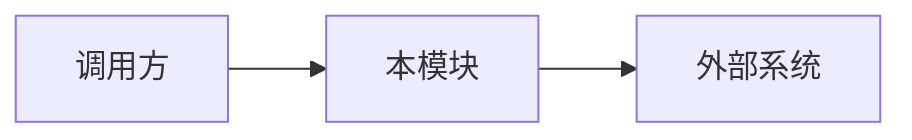
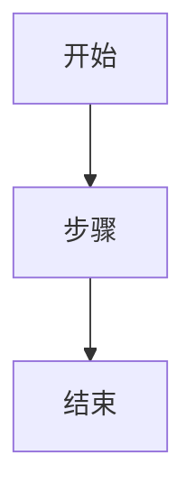
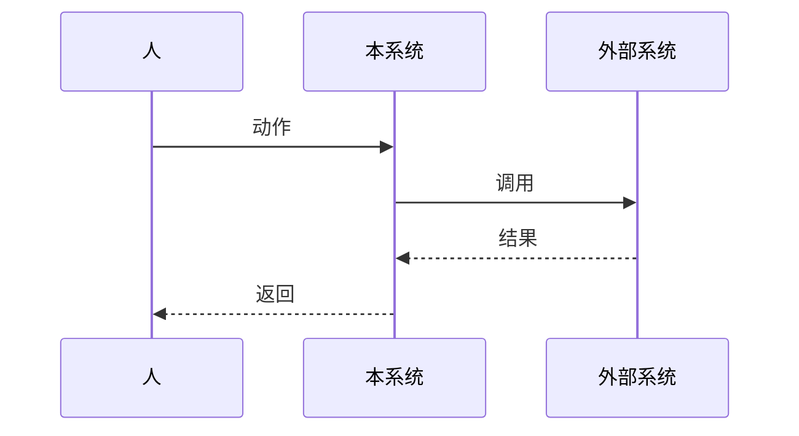

# {标题}

> 填写说明：复制本模板后填写。定稿时删掉所有「填写说明」。本文可选，由作者决定写不写。它与 spec、ADR 各是一套文档。成稿放进项目，且下面的决议为通过、条件为「无」之后，再据此生成 spec、ticket、ADR。

日期：YYYY-MM-DD

会上要拍板的一句话：{这次会议要决定的那一件事}

## 背景

> 填写说明：写现在怎么回事，以及为什么现在做。讲得完即可。

## 目标与非目标

> 填写说明：列出这次要做的，以及明确不做的。非目标写具体，会上需要被接受。

### 做

-

### 明确不做

-

## 推荐方案

> 填写说明：写模块落在哪里、主流程、必须守住的不变量。图用 mermaid 嵌在文中。碰到模块边界或外部系统时保留架构图；有多步流程时保留流程图；流程跨人、本系统、外部系统时改用泳道图。三张图不要求齐全。没有跨模块流程时删掉图，写「无跨模块流程，图省略」。不用的骨架删掉。

### 方案

### 不变量

-

### 架构图

### 流程图

### 泳道图

## 数据库改动

> 填写说明：每张新增或变更的表逐列写完，并写上主键、唯一约束、索引、审计字段和删除方式。一张表一块。没有表变更时，删掉下面的样例，写「不涉及」。

### {表名}

用途：

| 列 | 类型 | 约束 | 说明 |
|---|---|---|---|
| id | | 主键 | |
| | | | |

- 主键：
- 唯一约束：
- 索引：
- 审计字段：
- 删除方式：

## 取舍

> 填写说明：把推荐方案、否掉的方案和选择理由写全。以后的 ADR 从这里生成。

| 议题 | 推荐 | 否掉的方案 | 理由 |
|---|---|---|---|
| | | | |

## 影响面

> 填写说明：没碰到的项写「不涉及」。表的列定义见「数据库改动」。

- 模块边界：
- 表：见「数据库改动」
- 状态机：
- 模块之间的调用：
- 外部系统：
- 权限与菜单：
- 安全与审计：

## 风险与待决

> 填写说明：写下会上还要定的问题。已经定了的放进「取舍」。

-

## 验收与后续拆分

> 填写说明：写怎样算做完，以及建议拆成哪些工作。这里只列工作，不创建 ticket。以后的 ticket 从这里生成。

### 怎样算做完

-

### 建议拆分

1.

## 主持人清单

> 填写说明：会上逐项过。定稿时可删。

- [ ] 非目标已被接受
- [ ] 图已按规则保留，或已写明「无跨模块流程，图省略」
- [ ] 数据库改动已逐列写完，或已写明「不涉及」
- [ ] 待决已清零，或已写进决议的条件

## 决议

> 填写说明：结论为「通过」且条件为「无」时，本文可以用来生成 spec、ticket、ADR。条件还在时，先改本文，再开下一轮会。

- 日期：
- 结论：通过 / 不通过
- 条件：无
